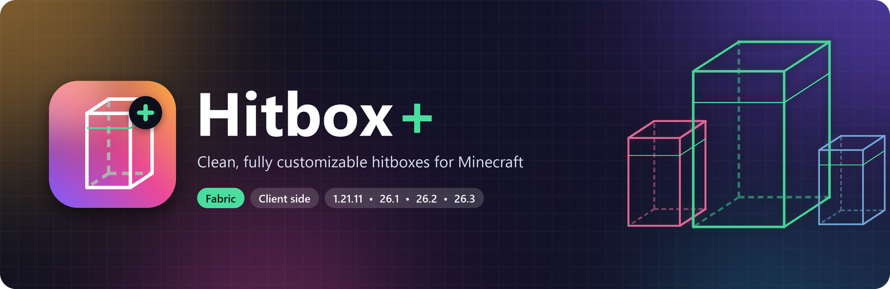
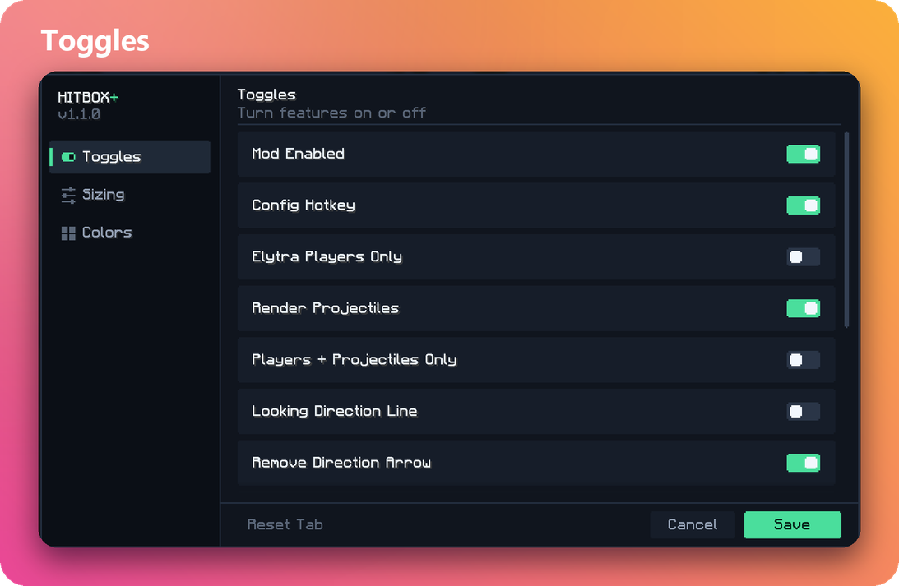
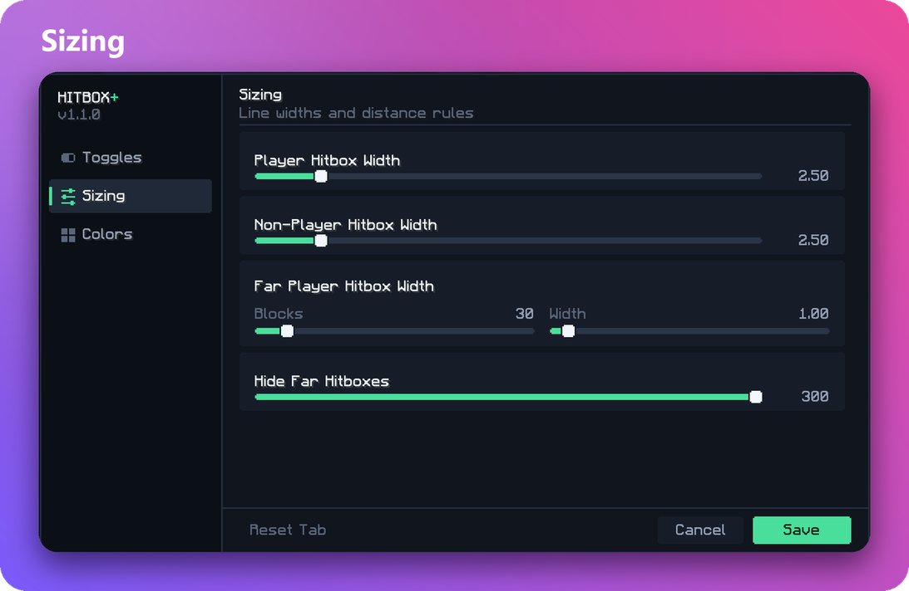
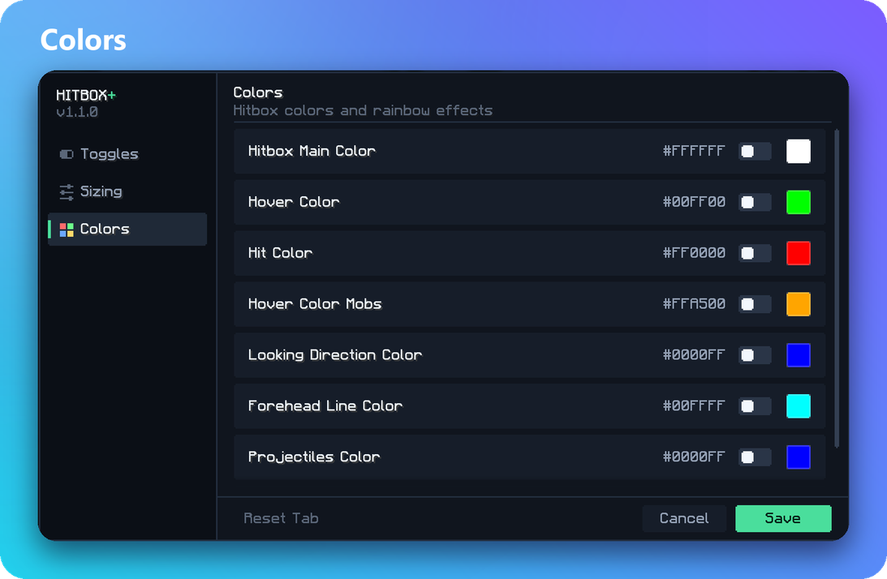
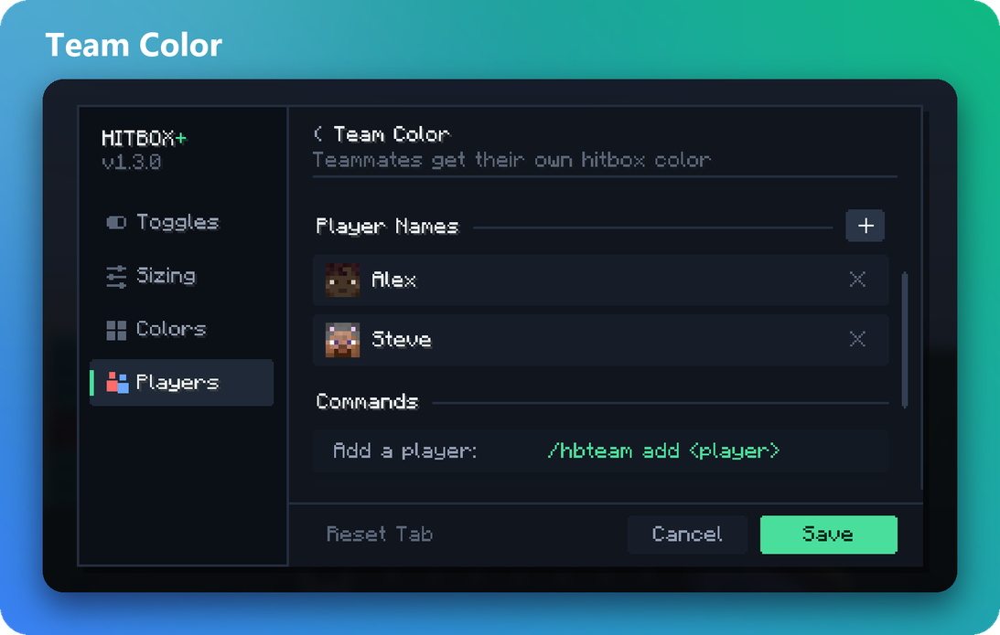
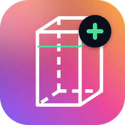

<div align="center">



<br>
<br>

<a href="https://modrinth.com/mod/hitbox-plus"></a>
<a href="https://modrinth.com/mod/hitbox-plus/versions"></a>
<a href="https://modrinth.com/mod/hitbox-plus/versions"></a>
<a href="LICENSE"></a>

<h3>
  <a href="https://modrinth.com/mod/hitbox-plus">Download on Modrinth</a>
  &nbsp;&nbsp;•&nbsp;&nbsp;
  <a href="https://github.com/ItzzWater/Hitbox-Plus/releases">GitHub Releases</a>
  &nbsp;&nbsp;•&nbsp;&nbsp;
  <a href="https://discord.gg/ubMnbmt6Mx">Discord</a>
</h3>

</div>

<br>

## What is Hitbox+?

Vanilla Minecraft can show hitboxes with `F3 + B`, but they are thin, all one color, and you can't change anything about them.

**Hitbox+** is a small client side Fabric mod that gives you full control over how hitboxes look and behave. You can make them thicker, color them, hide the ones you don't care about, and have them light up when your attack would actually land. It is built for PvP practice, UHC, minigames, or anyone who just wants clearer hitboxes.

It runs only on your game. Servers don't need it, and it works on any server you join.

The live download count is on the [Modrinth project page](https://modrinth.com/mod/hitbox-plus). The badge above pulls the same number straight from Modrinth.

<br>

## Features

**Looks**
* Pick your own line width for players, for mobs, and for players that are far away
* Custom colors with a full RGB color picker, plus a rainbow effect on any color
* Optional looking direction line and a forehead (eye height) line
* Option to show your own hitbox in third person

**Smart colors**
* **Hover color** turns a hitbox green when a left click right now would hit that entity. It uses Minecraft's own attack logic, so it respects your real reach, spears and weapon attack ranges
* **Hit color** flashes red only after a hit is confirmed, not just when you swing
* **Team Color** gives your teammates their own color so you can find them in crowded fights

**Filters**
* Players and projectiles only mode (hides mobs and animals)
* Elytra only mode, so you only see players who are wearing an Elytra
* Hide firework rockets and arrows stuck in the ground
* Stop drawing hitboxes after a set distance

**Easy to use**
* Clean config screen with four tabs: Toggles, Sizing, Colors and Players
* Press `O` in game to open it, or open it from Mod Menu
* `/hbteam` commands to manage your team from chat

<br>

## Screenshots

<div align="center">

&nbsp;

<br>

&nbsp;

</div>

<br>

## Installation

1. Install [Fabric Loader](https://fabricmc.net/use/installer/) for your Minecraft version
2. Download the three required mods listed below and put them in your `mods` folder
3. Download Hitbox+ from [Modrinth](https://modrinth.com/mod/hitbox-plus/versions) or [GitHub Releases](https://github.com/ItzzWater/Hitbox-Plus/releases) and put it in the same folder
4. Start the game, press `F3 + B` to show hitboxes, then press `O` to customize them

<br>

## Dependencies

All three are required. Hitbox+ will not load without them.

| Mod | Why Hitbox+ needs it | Download |
| :-- | :-- | :-- |
| **Fabric API** | Key bindings, client commands and tick events | [Modrinth](https://modrinth.com/mod/fabric-api) |
| **Cloth Config API** | Listed as required in the mod metadata | [Modrinth](https://modrinth.com/mod/cloth-config) |
| **Mod Menu** | Lets you open the settings from the mods list | [Modrinth](https://modrinth.com/mod/modmenu) |

<br>

## Supported versions

Each Minecraft version lives in its own folder, and each folder is a complete Gradle project.

| Folder | Minecraft | Java | Fabric Loader | Fabric API | Mappings |
| :-- | :-- | :-- | :-- | :-- | :-- |
| [`1.21.11/`](1.21.11) | 1.21.11 | 21 | 0.18.4 | 0.141.3+1.21.11 | Yarn |
| [`26.1/`](26.1) | 26.1, 26.1.1, 26.1.2 | 25 | 0.19.2 | 0.146.1+26.1.2 | Official (Mojang) |
| [`26.2/`](26.2) | 26.2 | 25 | 0.19.3 | 0.152.2+26.2 | Official (Mojang) |
| [`26.3/`](26.3) | 26.3 | 25 | 0.19.5 | 0.161.0+26.3 | Official (Mojang) |

The exact Cloth Config and Mod Menu versions for each folder are in its `gradle.properties`.

<br>

## Commands

| Command | What it does |
| :-- | :-- |
| `/hbteam` | Shows the help message |
| `/hbteam add <player>` | Adds a player to your team. Tab completes names from the server's player list |
| `/hbteam remove <player>` | Removes a player from your team |
| `/hbteam list` | Shows everyone on your team |
| `/hbteam clear` | Empties your team |

The command is called `hbteam` on purpose, so it never hides a server's own `/team` command.

<br>

## Building from source

You need **Git** and a **JDK**. Use JDK 25 for the 26.x folders and JDK 21 or newer for `1.21.11`. Gradle finds the right JDK on your computer by itself, and the Gradle wrapper is included, so you don't need to install Gradle.

```bash
git clone https://github.com/ItzzWater/Hitbox-Plus.git
cd Hitbox-Plus/26.3
./gradlew build
```

On Windows use `gradlew.bat build` instead of `./gradlew build`.

The finished mod is saved to `build/libs/hitboxesplus-<version>.jar`. To build for a different Minecraft version, run the same command inside that version's folder.

To test the mod in a real game while you work on it:

```bash
./gradlew runClient
```

<br>

## How it works

Hitbox+ is small on purpose. It changes two vanilla classes through Mixins and does everything else with plain Java.

```
src/main/java/itzglecni/customhitboxes/
├── CustomHitboxes.java       Mod entry point: loads config, registers the O key and /hbteam
├── mixin/
│   ├── EntityRenderManagerMixin.java             Replaces vanilla hitbox drawing
│   └── ClientPlayerInteractionManagerMixin.java  Records your attacks
├── tracker/
│   ├── HoverPicker.java      Asks Minecraft what a click right now would hit
│   └── HitTracker.java       Confirms which attacks really landed
├── config/                   Settings, JSON saving and team name rules
├── command/                  The /hbteam client command
└── gui/                      The config screen and color picker
```

**Drawing.** On 26.x the mod hooks into `EntityHitboxDebugRenderer.emitGizmos`, cancels the vanilla pass, and draws its own boxes and lines through Minecraft's gizmo system. Entities outside your view or past your distance limit are skipped before any drawing happens, and positions are smoothed with the frame's partial tick so boxes never jitter. On 1.21.11 the same idea is done through the older `render` and `drawHitbox` methods.

**Hover.** `HoverPicker` doesn't use its own raycast. It calls the same methods Minecraft uses when you left click, so the green hover color always matches what your attack would actually hit, including spears that pierce through several entities.

**Hits.** When you attack, `HitTracker` remembers the target for a short moment. The hit color only shows if that entity actually takes damage inside that window, so missed swings and blocked hits don't flash red.

**Config.** Settings are saved to `config/hitboxesplus.json`. Every value is checked and clamped when it loads, so a broken file can't crash the game. Older `customhitboxes.json` files are moved over automatically.

<br>

## Repository layout

```
Hitbox-Plus/
├── 1.21.11/       Source for Minecraft 1.21.11
├── 26.1/          Source for Minecraft 26.1.x
├── 26.2/          Source for Minecraft 26.2
├── 26.3/          Source for Minecraft 26.3
├── .github/       Build workflow, issue templates and README images
├── CHANGELOG.md
├── CONTRIBUTING.md
└── LICENSE
```

<br>

## Contributing

Bug reports, ideas and pull requests are all welcome. Please read [CONTRIBUTING.md](CONTRIBUTING.md) first. It explains how the version folders work and how to test a change.

Found a bug? [Open an issue](https://github.com/ItzzWater/Hitbox-Plus/issues/new/choose) or ask on [Discord](https://discord.gg/ubMnbmt6Mx).

<br>

## License

Hitbox+ is released under the [MIT License](LICENSE). You are free to use, change and share it.

<br>

<div align="center">



<br>

Made by **ItzGlecni** for the Minecraft community

<a href="https://modrinth.com/mod/hitbox-plus">Modrinth</a> &nbsp;•&nbsp; <a href="https://discord.gg/ubMnbmt6Mx">Discord</a>

</div>
